# FINAL ENTITY-RELATIONSHIP DIAGRAMS (ERD) — MULTIBRANCH DENTAL CLINIC OPERATIONS PLATFORM

**Date:** October 26, 2026 
**Audience:** Joevan (Database Administrator), Engineering Team, Defense Committee 
**Total Tables Documented:** 91 Active Tables (83 Domain + 8 Framework) 
**Foreign Key Constraints (FK):** ~232 [ESTIMATED database constraints] 
**Format:** Native Mermaid `erDiagram` Specifications 

---

## 1. Architectural Invariants, Date Discrepancy & Evidence Standards

### 1.1 Date Discrepancy & Future-Dated Migrations
* **Audit Date:** October 26, 2026.
* **Future-Dated Migration Files:** Exactly **28 migration files** (#56 to #83) in `backend/database/migrations/` bear filename timestamp prefixes dated after October 26, 2026 (ranging from October 27 to November 16, 2026). Future timestamp prefixes are a possible explanation (e.g., forward-dated sprint milestone identifiers), but this convention has not been formally confirmed by the project owner.
* **Migration Renaming & Tracking Invariant:** Changing the filename of a migration that has already run can cause Laravel to treat the renamed file as a different, pending migration because the recorded name in the `migrations` table no longer matches. Depending on the migration, re-execution may fail or cause unintended schema changes. Therefore, do not rename applied migrations without a reviewed migration-history and deployment plan.
* **Owner-Reported Production Status vs. Filename Contradiction:** Migration 77's production status remains owner-reported (`2026_11_15_000100_add_archive_columns_to_core_tables.php` was communicated as already applied on production `dental_clinic`), not independently verified by this static audit. This date contradiction (dated November 15 but reported applied on or before October 26) is preserved as reported but explicitly marked as **[Not verified on hosted Supabase]**.
* **Local Test vs. Hosted Status:** Migration 83 is recorded as `Ran` in local `dental_clinic_test`; its hosted Supabase status remains unverified. Joevan must independently confirm hosted status using read-only verification queries.

### 1.2 Evidence Classifications & Safety Scope
* **Audit Safety Scope:** This corrective documentation pass performed **zero database queries, zero SQL executions, and zero Git index or worktree mutations**. Earlier development workflow steps in prior turns included focused local testing against `dental_clinic_test`. Neither production `dental_clinic` nor hosted Supabase has been inspected.
* **Exact vs. Estimated Metrics:**
  * Active Canonical Tables: **91 tables** (83 domain + 8 framework) **[EXACT]** — derived from 92 unique tables created minus 1 dropped (`patient_feedback`).
  * Total Columns: **1,111 physical columns** **[EXACT]** — distinct physical column definitions in the intended final schema across all 91 canonical tables, after applying migration-created columns, later additions and alterations, and documented drops (exhaustively documented in `FINAL-ERD-DICTIONARY.md`). Excludes Markdown headers, separator rows, descriptions, constraint notes, and relationship notes.
  * Migration-Defined Triggers: **44 triggers** **[EXACT]** — net active triggers in migrations (45 created in up() minus 1 dropped).
  * Trigger-Protected Tables: **40 distinct tables** **[EXACT]** — accounting for 4 overlapping tables (`audit_logs`, `loyalty_ledger`, `loyalty_lot_consumptions`, `treatments`).
  * Foreign Keys: **~232 constraints** **[ESTIMATED]** — static source estimate.
  * Unique Constraints & Indexes: **~106 constraints/indexes** **[ESTIMATED]** — static source estimate.
  * Check Constraints: **~125 constraints** **[ESTIMATED]** — static net active check constraints.
  * Plain Secondary Indexes: **~58 indexes** **[ESTIMATED]** — static source estimate.
* **STF-04 Scope Boundary:** In `CounterIntake.jsx`, the receptionist counter form provides an "Other valid ID" text field (`other_details`). Backend request validation and database persistence for this field remain **pending approval** (recorded as **Partial / In Progress**). This missing persistence is an incomplete implementation item awaiting client/team approval, **NOT** an intentional final design decision. No column is added to `intake_submissions`.
* **Multi-Tier Retention Model:**
  * `users` uses Laravel Eloquent soft deletion (`deleted_at`).
  * `invoices`, `visits`, `prescriptions`, and `user_notifications` contain archive metadata (`archived_at`, `archived_by_user_id`, `archive_reason`).
  * 40 tables are protected by 44 PostgreSQL engine-level triggers.
  * 20 specific backend delete operations handle ephemeral authentication sessions, tokens, scope re-syncs, and unfinalized draft procedure/prescription lines.
  * `patient_feedback` was permanently dropped in migration 76 and is omitted from all diagrams.

---
## 2. Global Core Domain Architecture Overview

The following high-level diagram visualizes the primary aggregate roots and relational backbone of the multi-branch dental clinic system:

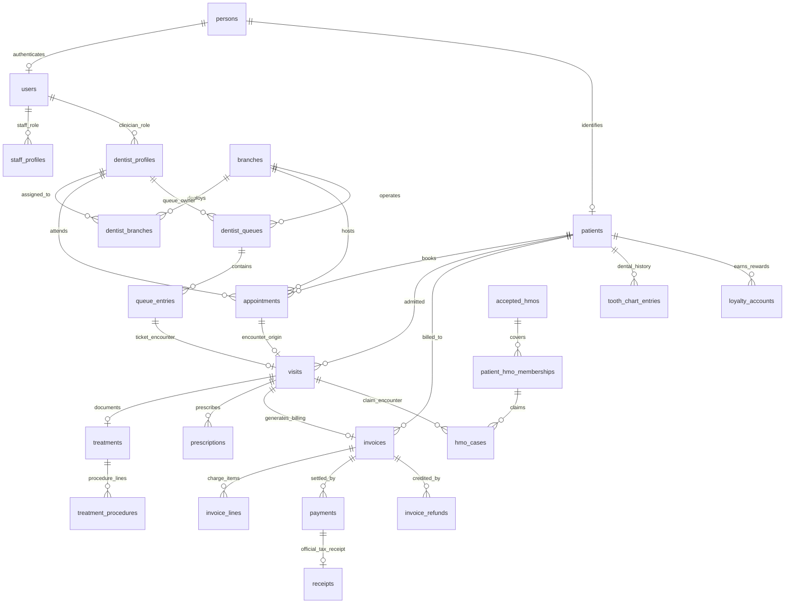

---

## 3. Modular Subsystem Entity-Relationship Diagrams

To provide complete relational fidelity without overwhelming diagram parsers, the 91 active tables are documented across 12 focused subsystem domain models below. Every table, column type, key, and relationship is derived from audited PostgreSQL migration definitions.

### Subsystem 1: Identity, Authentication & Framework Infrastructure

*Foundational identity aggregate (persons, users), branch associations, authentication tokens, and Laravel framework session/job/cache tables.*

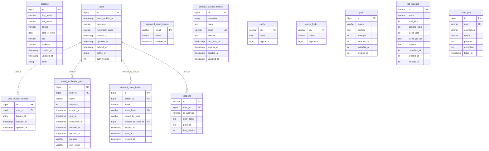

### Subsystem 2: Clinic Facilities, Closures & System Configuration

*Physical branch infrastructure, operational closure calendars, global clinic configuration settings, command keys, and billing cutovers.*

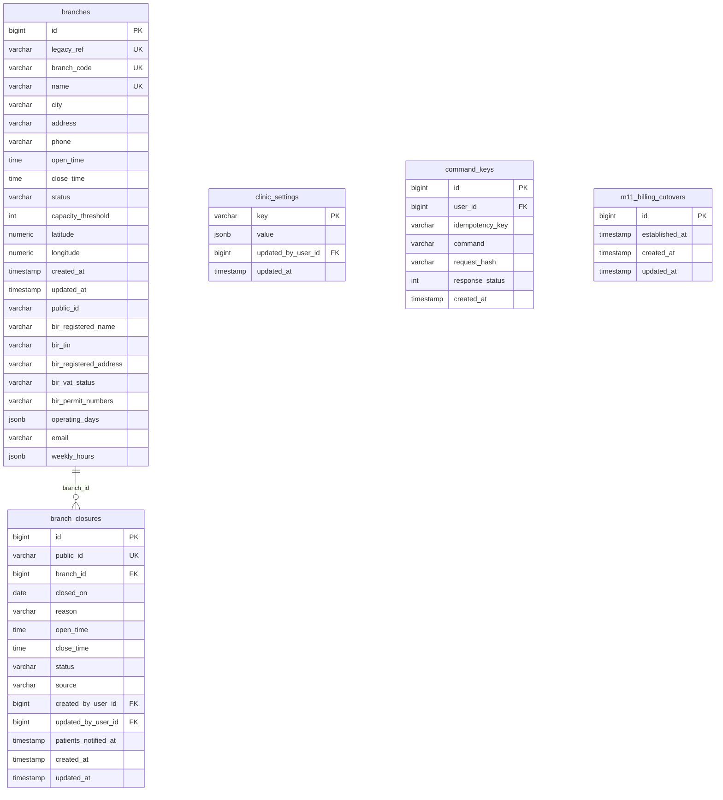

### Subsystem 3: Personnel Rosters, Dentist Availability, Leave & Handovers

*Clinical and staff profiles, branch affiliations, recurring schedules, exceptions, coverage-first leave requests, and clinical shift handovers.*

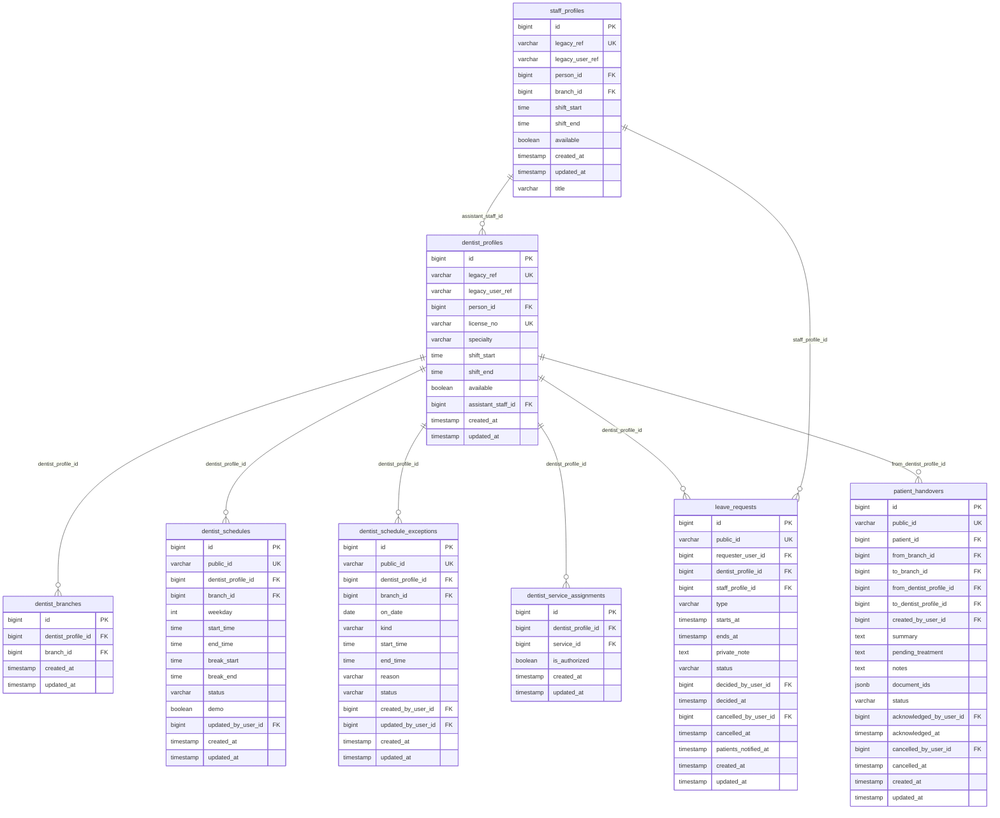

### Subsystem 4: Dental Services, Fee Schedules & Pricing

*Master service catalog, branch-level service offerings, and append-only versioned fee schedules.*

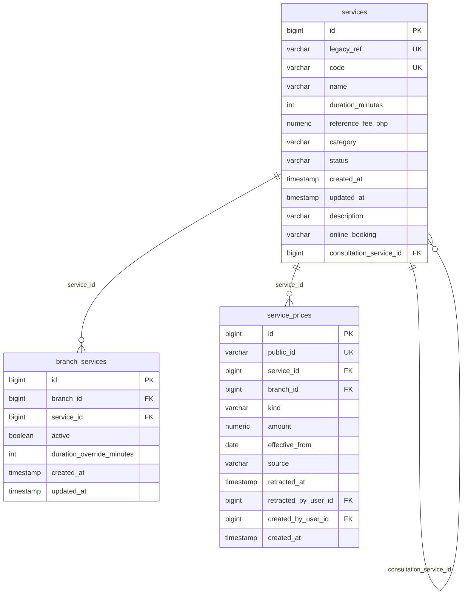

### Subsystem 5: Patient Master Records, Guardianship & Intake Submissions

*Patient master profiles, legal guardian relationships, daily branch join codes, check-in intake submissions, and consent records.*

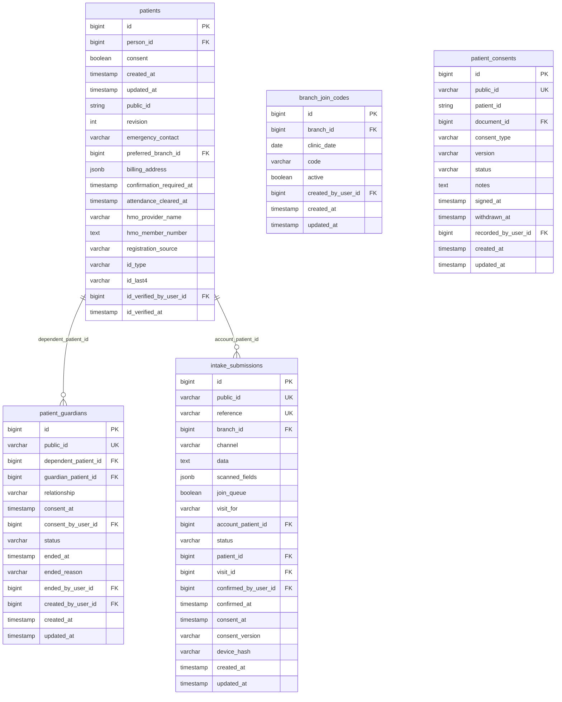

### Subsystem 6: Appointments, Scheduling Engine, Rescheduling & Waitlists

*Central appointment booking entities, immutable rescheduling history, slot openings, offers, no-show flags, and prioritized waitlists.*

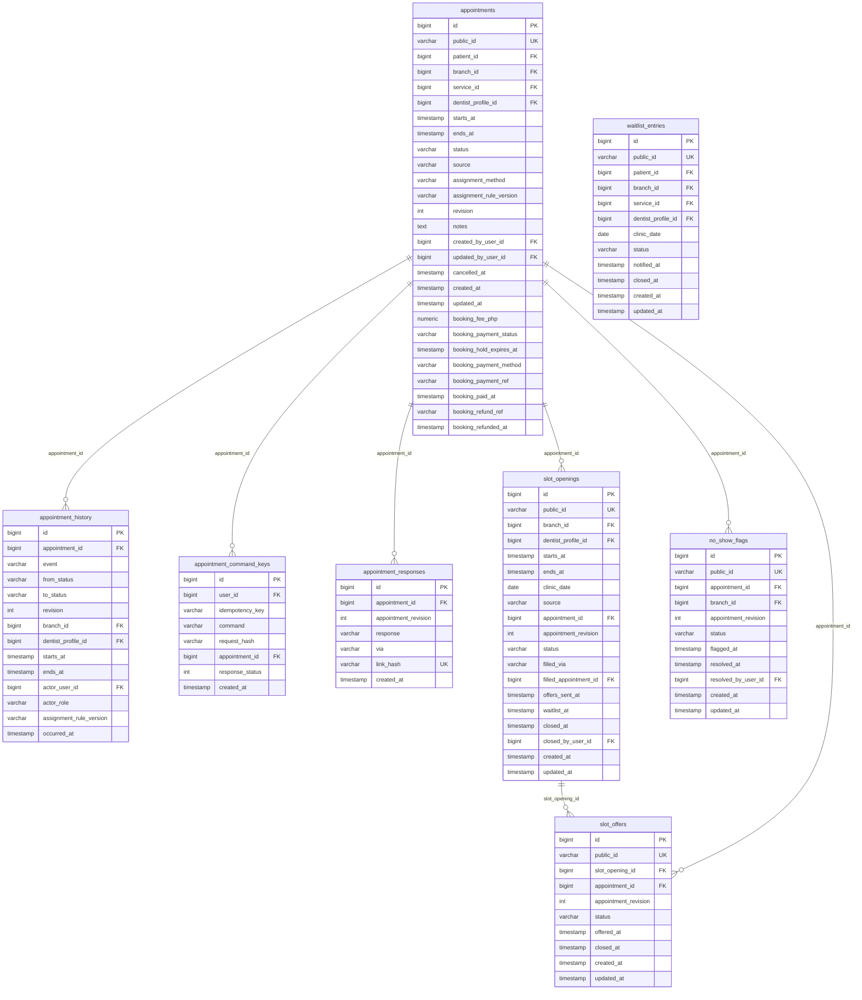

### Subsystem 7: Live Clinic Flow, Queues & Encounter Check-In

*Dentist queues, daily queue tickets, state change histories, clinical visit admissions, and encounter timelines.*

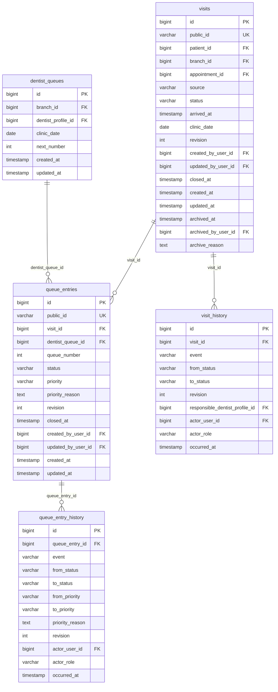

### Subsystem 8: Clinical Encounters, Treatments, Procedures & Tooth Charts

*Doctor clinical notes, completed procedures, treatment history, follow-up recalls, and tooth chart odontogram condition entries.*

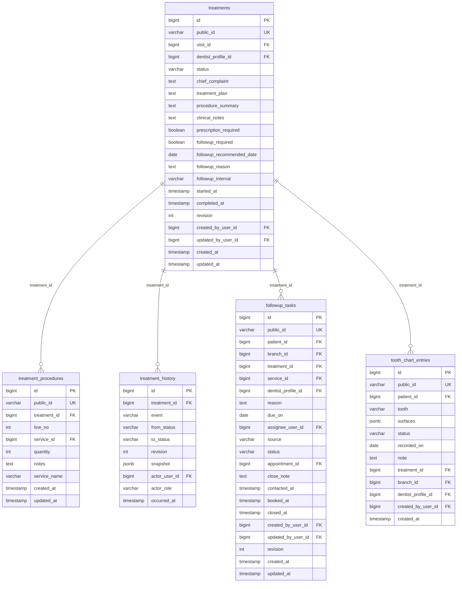

### Subsystem 9: Prescriptions & Pharmacy Dispensation

*Doctor digital prescriptions, line items, dosage/frequency instructions, and sequential prescription counter tracking.*

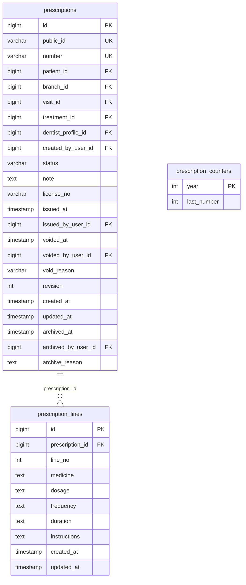

### Subsystem 10: Invoicing, Payments, PayMongo Gateway & Receipts

*Statements of account (invoices), line items, billing history snapshots, refund credit notes, payments, official receipts, and PayMongo webhook/checkout sessions.*

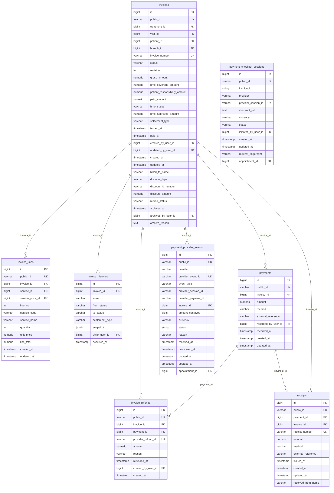

### Subsystem 11: HMO Providers, Patient Coverage & Claims Adjudication

*Accredited HMO insurance providers, patient memberships, pre-authorization cases, checklist requirements, and claim adjudication event trails.*

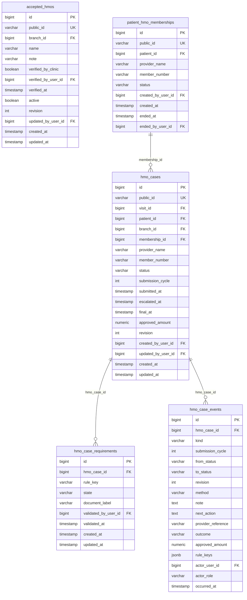

### Subsystem 12: Audit Trails, OCR Documents, Communications & Loyalty

*Tamper-evident audit logs, OCR documents, patient-staff messaging, notifications, mail dispatch, portal inquiries, AI telemetry, and M24 loyalty rewards.*

```mermaid
erDiagram
    audit_logs {
bigint id PK
varchar public_id UK
bigint actor_user_id FK
varchar actor_role
varchar actor_name
bigint branch_id FK
varchar action
varchar category
varchar auditable_public_id
varchar ip_address
text user_agent
jsonb payload
timestamp created_at
    }
    documents {
bigint id PK
varchar public_id UK
string patient_id
string visit_id
string hmo_case_id
bigint branch_id FK
varchar category
varchar title
string file_path
varchar original_filename
varchar mime_type
bigint file_size_bytes
string checksum_sha256
varchar status
jsonb metadata
bigint uploaded_by_user_id FK
timestamp retracted_at
bigint retracted_by_user_id FK
varchar retraction_reason
timestamp created_at
timestamp updated_at
    }
    document_extractions {
bigint id PK
varchar public_id UK
string document_id
varchar extraction_method
varchar status
text raw_text
jsonb structured_payload
numeric confidence_score
timestamp extracted_at
timestamp created_at
timestamp updated_at
    }
    conversations {
bigint id PK
varchar public_id UK
bigint patient_id FK
bigint branch_id FK
varchar context
varchar status
int revision
timestamp closed_at
bigint closed_by_user_id FK
bigint created_by_user_id FK
timestamp created_at
timestamp updated_at
    }
    conversation_participants {
bigint id PK
bigint conversation_id FK
string user_id
bigint last_read_message_id
timestamp last_read_at
timestamp created_at
    }
    conversation_messages {
bigint id PK
varchar public_id UK
bigint conversation_id FK
bigint sender_user_id FK
text body
timestamp created_at
    }
    message_templates {
varchar key PK
varchar subject
text body
boolean needs_dentist
int revision
bigint approved_by_user_id FK
timestamp approved_at
bigint dentist_approved_by_user_id FK
timestamp dentist_approved_at
bigint updated_by_user_id FK
timestamp created_at
timestamp updated_at
    }
    mail_dispatches {
bigint id PK
varchar public_id UK
varchar purpose
varchar subject_type
varchar subject_public_id
int subject_revision
bigint recipient_user_id FK
bigint created_by_user_id FK
boolean retryable
varchar status
int attempts
int max_attempts
timestamp next_attempt_at
timestamp locked_at
varchar failure_reason
varchar mailer
varchar transport_kind
timestamp completed_at
timestamp delivery_confirmed_at
timestamp created_at
timestamp updated_at
    }
    mail_dispatch_attempts {
bigint id PK
bigint mail_dispatch_id FK
int attempt_no
varchar outcome
varchar mailer
varchar transport_kind
timestamp started_at
timestamp finished_at
    }
    user_notifications {
bigint id PK
varchar public_id UK
bigint user_id FK
varchar kind
varchar title
varchar body
varchar target_page
varchar target_id
varchar dedupe_key UK
timestamp created_at
timestamp read_at
timestamp archived_at
bigint archived_by_user_id FK
text archive_reason
    }
    inquiries {
bigint id PK
varchar public_id UK
varchar source
varchar capture_method
varchar contact_name
varchar contact_detail
varchar topic
bigint branch_id FK
bigint assigned_user_id FK
bigint created_by_user_id FK
bigint patient_id FK
bigint appointment_id FK
varchar status
int revision
timestamp received_at
timestamp responded_at
timestamp closed_at
timestamp converted_at
timestamp created_at
timestamp updated_at
    }
    inquiry_history {
bigint id PK
bigint inquiry_id FK
varchar event
varchar from_status
varchar to_status
int revision
varchar actor_role
timestamp occurred_at
    }
    assistant_answers {
bigint id PK
varchar public_id UK
varchar seed_key UK
varchar question
varchar answer
jsonb keywords
varchar category
bigint branch_id FK
boolean active
boolean draft
varchar source
int revision
bigint updated_by FK
timestamp created_at
timestamp updated_at
    }
    assistant_usage {
bigint id PK
bigint user_id FK
date clinic_date
varchar mode
varchar outcome
jsonb tools
int input_tokens
int output_tokens
int latency_ms
timestamp created_at
    }
    automated_actions {
bigint id PK
varchar public_id UK
bigint workflow_rule_id FK
bigint system_event_id FK
varchar idempotency_key UK
varchar status
jsonb details
timestamp executed_at
timestamp created_at
    }
    automation_settings {
varchar key PK
boolean enabled
jsonb settings
int revision
timestamp last_run_at
bigint updated_by_user_id FK
timestamp created_at
timestamp updated_at
    }
    automation_deliveries {
bigint id PK
varchar automation
varchar dedupe_key UK
varchar outcome
varchar reason
varchar subject_type
varchar subject_public_id
bigint branch_id FK
bigint mail_dispatch_id FK
timestamp created_at
    }
    workflow_rules {
bigint id PK
varchar public_id UK
varchar rule_code UK
varchar name
varchar trigger_event
jsonb target_domains
text condition_description
text action_description
varchar owner_domain
boolean is_active
boolean is_system_protected
timestamp created_at
timestamp updated_at
    }
    system_events {
bigint id PK
varchar public_id UK
varchar event_type
varchar idempotency_key UK
varchar domain
varchar aggregate_type
varchar aggregate_id
bigint branch_id FK
bigint actor_user_id FK
jsonb payload
timestamp occurred_at
timestamp created_at
    }
    loyalty_accounts {
bigint id PK
varchar public_id UK
bigint patient_id FK
bigint branch_id FK
varchar referral_code UK
int current_balance
timestamp created_at
timestamp updated_at
    }
    loyalty_ledger {
bigint id PK
varchar public_id UK
bigint loyalty_account_id FK
bigint branch_id FK
int points
varchar entry_type
varchar reason_code
string reverses_entry_id
bigint refund_id FK
bigint invoice_id FK
bigint visit_id FK
bigint referral_id FK
varchar idempotency_key UK
timestamp expires_at
int unrecovered_points
bigint created_by_user_id FK
timestamp created_at
    }
    loyalty_lot_consumptions {
bigint id PK
varchar public_id UK
bigint redeem_entry_id FK
bigint earn_entry_id FK
int points
timestamp created_at
    }
    referrals {
bigint id PK
varchar public_id UK
string referrer_patient_id
bigint referee_patient_id FK
varchar referral_code_used
varchar status
bigint qualifying_invoice_id FK
timestamp qualified_at
timestamp rewarded_at
timestamp created_at
timestamp updated_at
    }
    conversations ||--o{ conversation_participants : "conversation_id"
    conversations ||--o{ conversation_messages : "conversation_id"
    mail_dispatches ||--o{ mail_dispatch_attempts : "mail_dispatch_id"
    inquiries ||--o{ inquiry_history : "inquiry_id"
    workflow_rules ||--o{ automated_actions : "workflow_rule_id"
    system_events ||--o{ automated_actions : "system_event_id"
    mail_dispatches ||--o{ automation_deliveries : "mail_dispatch_id"
    loyalty_accounts ||--o{ loyalty_ledger : "loyalty_account_id"
    referrals ||--o{ loyalty_ledger : "referral_id"
    loyalty_ledger ||--o{ loyalty_lot_consumptions : "redeem_entry_id"
```
