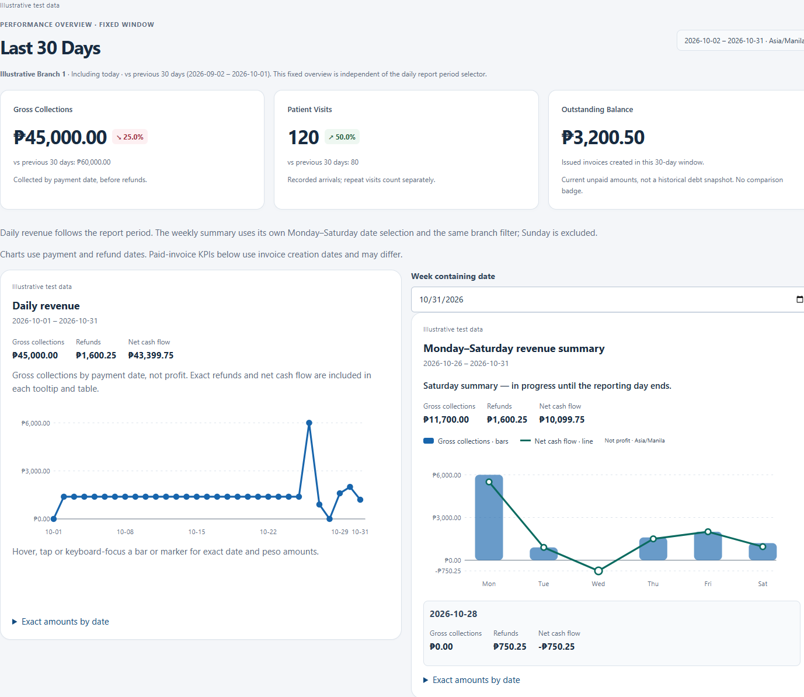
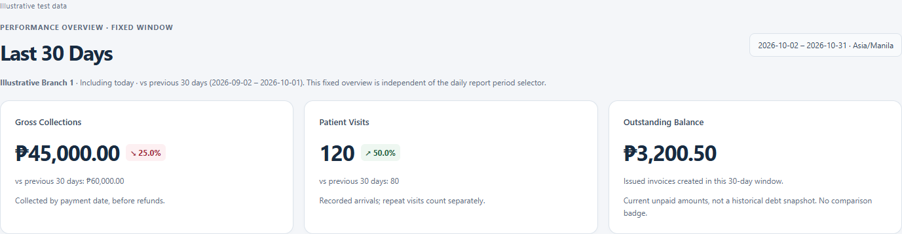
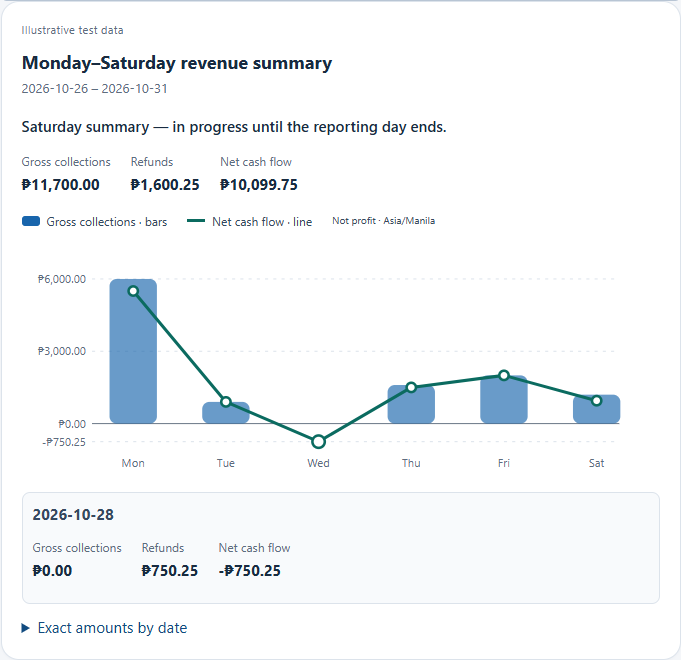
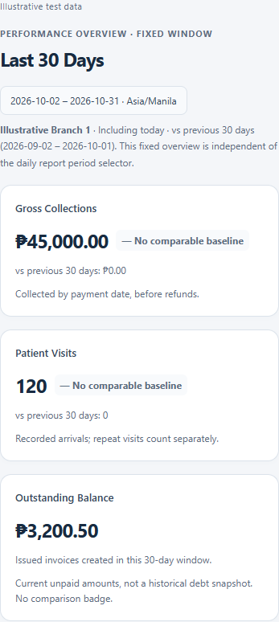

# Owner Analytics feature showcase

## A. Feature overview

Owner Analytics helps the clinic Owner review collections, recorded arrivals and outstanding invoice balances across authorized branches. It brings financial and operational signals together without exposing Patient identities or making clinical decisions. Reports describe activity; they do not predict profit or replace accounting review.

## B. Newly enhanced features

- **Last 30 Days cards:** exact peso collections, recorded Patient Visits and a clearly scoped outstanding balance.
- **Performance comparisons:** collections and visits show increases in green, decreases in red and no change neutrally, against the immediately preceding 30 days. An absent baseline is labelled honestly.
- **Daily revenue trend:** the existing gross-collections line follows the report-period selector.
- **Weekly combination chart:** rounded bars show gross collections; a connected line and markers show net cash flow, including negative days, on one peso scale.
- **Exact details:** hover, keyboard focus or tap selects a date and displays gross collections, refunds and net cash flow together. Expandable tables provide exact values without relying on charts or color.
- **Branch/date filtering:** the same authorized branch filter applies to the overview and charts. Daily and weekly reporting windows remain separately labelled.
- **Responsive reporting:** cards and charts stack on phones; exact-value tables can scroll within their own region.

## C. User workflow

1. Sign in as Owner and open **Analytics**.
2. Select a branch or **All Branches**.
3. Select the daily report period and, if needed, a date in the desired historical week. The separately labelled **Last 30 Days** cards always include today, regardless of the daily selector.
4. Review collections and visits against the preceding 30-day window. Read the outstanding-balance scope before interpreting it.
5. Hover, focus with the keyboard or tap a graph day to read its exact date and amounts.
6. Compare patterns, inspect refund days and expand **Exact amounts by date** for the accessible table.

## D. Calculations and data definitions

**Gross collections** come from the existing Laravel daily/weekly payment-date aggregation of recorded payments. Refunds are aggregated separately by refund date. These are not frontend invoice projections. **Net cash flow = gross collections − refunds**; a refund can make a day negative even without payments that day. Collections and net cash flow are not necessarily profit: these charts do not deduct operating expenses.

**Patient Visits** uses the executive summary's `patient_flow.total_visits`: server-recorded arrivals (`Visit` records) in the reporting window. Repeat visits count separately. This is neither unique people nor completed consultations/treatments.

**Outstanding Balance** uses `financials.outstanding_balance_php`: current remaining balances on qualifying issued invoices created within the selected 30-day window, under existing executive-summary rules. It is not all historical debt or an as-of-date snapshot. It has no prior-period badge.

Current dates are today minus 29 days through today; previous dates are today minus 59 through today minus 30. Both contain 30 consecutive **Asia/Manila calendar days**, use inclusive dates and the same branch scope. For illustrative today **2026-10-31**, current is **2026-10-02–2026-10-31** and previous is **2026-09-02–2026-10-01**. No partial-month/full-month comparison is implied. All Time for the daily chart does not change this explicitly fixed overview.

`percentage change = ((current − previous) / previous) × 100`

Amounts use exact BigInt centavos; comparison rounding also uses integer arithmetic, to one decimal place. Tiny nonzero changes show `<0.1%`. Zero previous values show **No comparable baseline**, rather than Infinity or an invented rate. Equal nonzero values show neutral 0.0%. SVG positioning alone uses Number coordinates.

Weekly charts contain the same six Monday–Saturday dates for both series; Sunday is excluded. Before Saturday, the current week requires explicit in-progress preview. On Saturday it is available but remains in progress. Existing server `is_finalized` becomes true after Saturday passes. This on-demand reporting-calendar status is not a scheduled stored report or immutable accounting close. Late records can affect historical reports.

## E. Screenshots and visual evidence

All images below are **Illustrative test data**, rendered from the real Owner Analytics component with synthetic API fixtures. No actual Patient identities or private clinic financial records were captured. Desktop viewport: 1440px; mobile viewport: 390px. Captures show a component crop or full scrolling page.

[Responsive mobile capture — Illustrative test data](assets/owner-analytics/mobile-overview.png).

The synthetic overview shows 45,000.00 pesos versus 60,000.00 (25.0% decrease), and 120 visits versus 80 (50.0% increase). Wednesday has no collections and a 750.25 refund, making net −750.25 pesos. These are acceptance examples, not clinic results.

## F. Technical implementation

React `AnalyticsPage` reuses `OwnerRevenueCharts` and adds `OwnerPerformanceOverview`. Scoped styles and SVG charts use existing clinic design tokens without new chart dependencies or global layout changes. `owner-revenue-data.js` validates decimal totals and branch projections, defines adjacent windows and generates a shared signed chart scale.

Existing clients call authorized Laravel `GET /api/analytics/daily-revenue`, `/weekly-histogram` and `/executive-summary`. Existing `AnalyticsController` and `AnalyticsService` remain authoritative for PostgreSQL payment/refund/date and arrival/invoice aggregation. No aggregation endpoint or financial rule changed in A5. Owner-only authorization and branch filters remain enforced. Keyed resources discard late responses and immediately remove previous-branch figures on filter changes; failures show unavailable states with retry instead of invented zero values.

## G. Testing and validation

- Focused Node tests: **30 passed**, covering exact money, comparison directions/baselines, equal date windows, scope checks, signed geometry, API mapping and existing analytics regressions.
- Focused PostgreSQL tests: **6 tests / 96 assertions passed**, using only a newly verified disposable scratch database. Coverage includes Owner/other-role access, branch filters, payment/refund reconciliation, current/prior windows, arrivals/outstanding scope and Saturday boundaries.
- Playwright MCP ran `runA5Acceptance` from `tests/owner-analytics-a5-rendered.mjs`: **1440px/390px passed** for KPI requests, indicators, keyboard/hover/click tooltips, tables, negative net, stale responses, zero baselines, loading and error/retry. Screenshots were captured during synthetic acceptance.
- Existing `runOwnerAnalyticsAcceptance` from `tests/owner-analytics-rendered.mjs` also passed both widths, including historical-week selection and pre-Saturday preview.
- Production build passed with the existing bundle-size warning. Full suites and production financial acceptance were not run for this focused batch.

Exact commands and database evidence: [A5 technical acceptance](../OWN01_A5_ACCEPTANCE.md).

## H. Scope and limitations

Historical financial snapshots are not automatically guaranteed. Saturday reports are on-demand and mutable, not immutable accounting closes. The overview supports fixed Last 30 Days comparisons; it does not invent baselines for All Time or arbitrary periods. Synthetic frontend fixtures and independent PostgreSQL tests are separate from actual clinic data. No live production financial acceptance, deployment, accounting certification or comprehensive accessibility audit is claimed.

## I. QA and version traceability

This extends **OWN-01**, following A4 commit `02a957d5db4af1687f8dc8aca045da3c2ab4a242`, integrated into development `integration/developer-a-b`. A5 is published separately on `feature/joevan-owner-analytics-a5-visuals-20261029` for review; its commit is available in that branch's history. See [QA-RICHMON](../../QA-RICHMON.md), [preserved A4 evidence](../OWN01_A4_ACCEPTANCE.md) and [A5 acceptance](../OWN01_A5_ACCEPTANCE.md). A5 does not auto-merge or constitute a production release.
